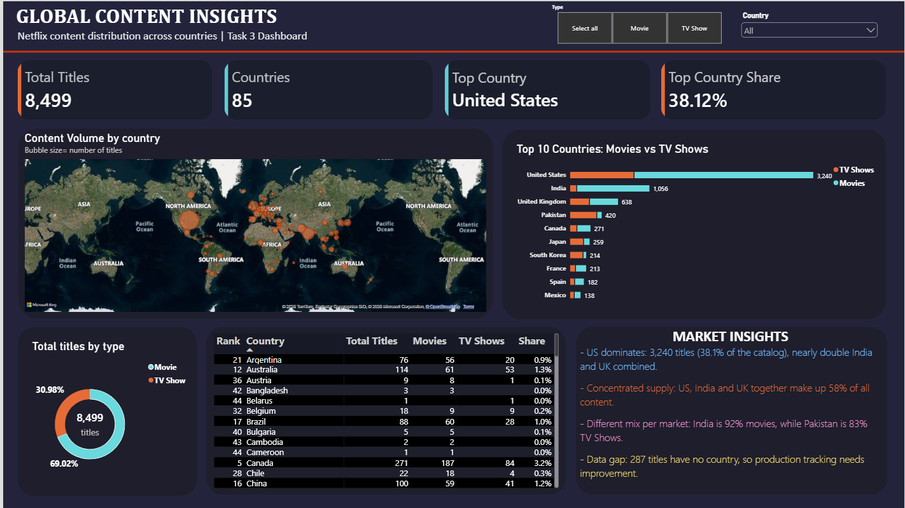
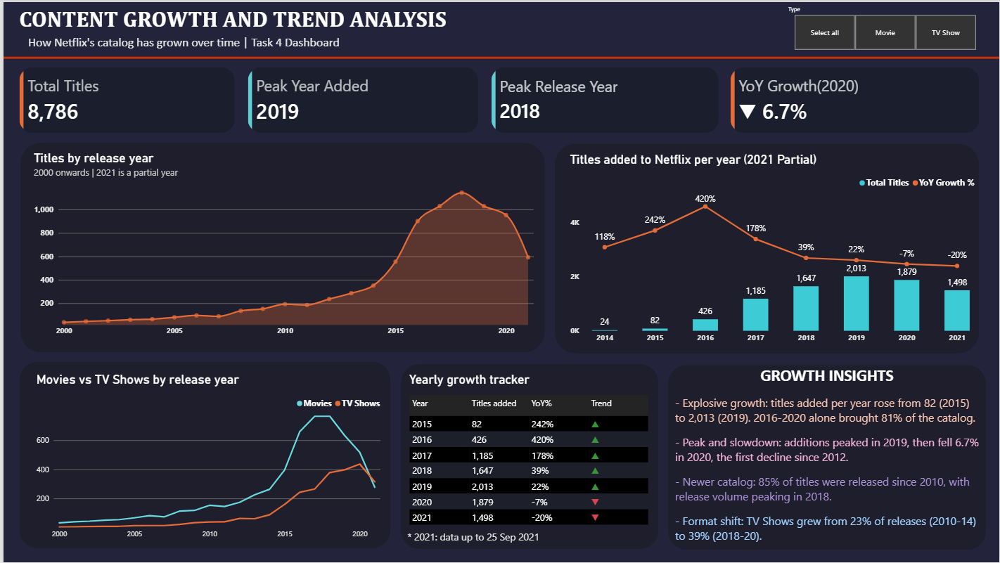
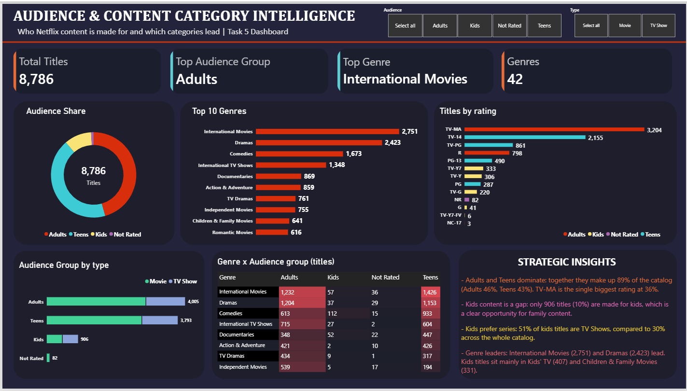
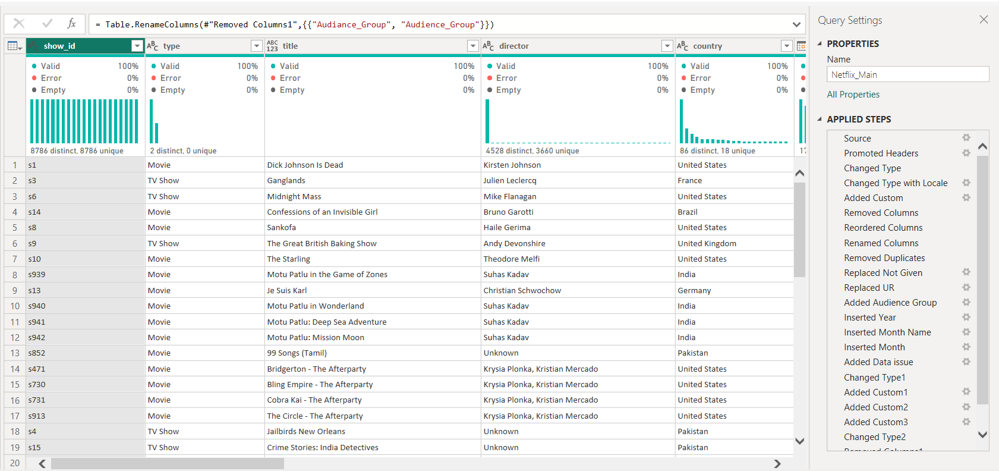
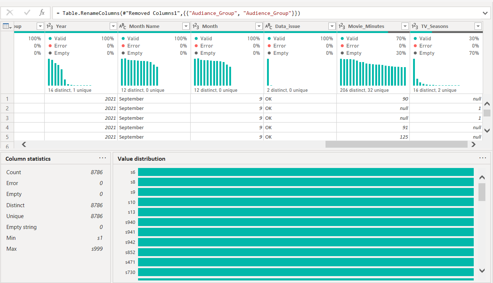
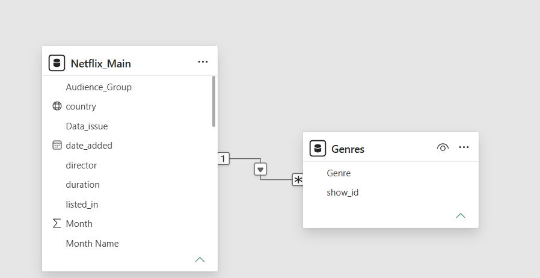

# Netflix Content Analytics | Power BI
### Interactive Dashboards • Data Transformation • Business Intelligence

An end-to-end Power BI analytics project developed as part of the **Auspify Technologies Power BI Internship Program**. This project explores Netflix's content catalogue through interactive dashboards, data preparation, data modelling, trend analysis, and content-category insights.

## Project Overview

The goal of this project is to transform raw Netflix catalogue data into structured, interactive reports that make content distribution and viewing-category patterns easier to explore.

The project covers the data preparation workflow and three analytical dashboards, combining Power Query transformations, a relational data model, visual analytics, and business-focused interpretation.

## Project Objectives

- Prepare and transform raw data using Power Query.
- Handle duplicate records and standardize data for analysis.
- Build relationships between the main Netflix dataset and genre data.
- Explore content distribution across countries and content types.
- Analyze release-year patterns and yearly catalogue additions.
- Compare audience groups, genres, and content ratings.
- Present findings through clear, interactive Power BI dashboards.

# Dashboard Gallery

## 1. Global Content Insights Dashboard
**Internship Task 3 | Geographic & Market Analysis**



### Analysis Covered
- Country-wise content distribution.
- Top countries by title count.
- Movies versus TV Shows comparison.
- Geographic content patterns.
- Interactive exploration of country-level data.

### Key Finding
The United States leads the country analysis with **3,240 titles**, representing approximately **38.12%** of the 8,499 titles included in that analysis.

### Business Perspective
Country-level analysis can help identify markets with a high concentration of catalogue titles and support further investigation into regional content distribution.

## 2. Content Growth & Trend Analysis Dashboard
**Internship Task 4 | Time-Series Analysis**



### Analysis Covered
- Content distribution by release year.
- Yearly additions to the Netflix catalogue.
- Year-over-year changes displayed in the report.
- Movies and TV Shows release patterns.
- Historical content-growth trends.

### Key Findings
- The displayed release-year analysis peaks in **2018**.
- Yearly catalogue additions peak in **2019** in the displayed analysis.
- The dashboard shows a decline in yearly additions after the peak.
- The 2021 additions figure is partial and should not be interpreted as a complete-year total.

### Business Perspective
Historical trends help distinguish changes in the catalogue over time. Partial-year data should be considered before drawing conclusions about a full year's performance.

## 3. Audience & Content Category Intelligence Dashboard
**Internship Task 5 | Category & Rating Analysis**



### Analysis Covered
- Audience-group distribution.
- Genre-level content analysis.
- Content ratings distribution.
- Movies versus TV Shows across audience groups.
- Comparisons across content categories.

### Key Findings
- **International Movies** is the leading genre shown in the dashboard.
- **TV-MA** is the most common rating displayed.
- Audience-group visuals compare the distribution of Movies and TV Shows.

### Business Perspective
Genre and rating distributions can help describe the composition of a content catalogue and identify categories for deeper analysis.

# Data Preparation & Modelling
**Internship Task 1 | Power Query & Power BI Setup**

## Power Query Transformation



The raw Netflix dataset was imported into Power BI and prepared for analysis using Power Query.

### Data Preparation Workflow
- Reviewed column names and data types.
- Removed unnecessary columns.
- Reordered and renamed fields.
- Removed duplicate records.
- Replaced placeholder values where appropriate.
- Created derived fields for further analysis.
- Prepared the data for reporting and visualization.

### Column Quality & Statistics



Power Query's column profiling features were used to review data quality and value distribution.

The selected column shown in the screenshot contains 8,786 values, with zero errors and zero empty values. This observation applies to the selected column, not every column in the dataset.

The `Movie_Minutes` and `TV_Seasons` fields contain null values, which may be appropriate where a field does not apply to a particular content type.

## Data Model & Relationships



The model includes a main Netflix table and a separate `Genres` table connected through `show_id`.

This structure supports analysis of title-level attributes alongside genre-level records.

# Key Metrics at a Glance

| Metric | Value |
|---|---:|
| Records in prepared main dataset | 8,786 |
| Countries represented in country analysis | 85 |
| Titles included in country analysis | 8,499 |
| Titles without country information | 287 |
| Leading country in the displayed analysis | United States |
| Leading genre displayed | International Movies |
| Most common rating displayed | TV-MA |

*Metrics are based on the supplied dataset and the included dashboard views. Results may vary according to filters and calculation logic.*

# Technical Skills Demonstrated

| Area | Tools & Techniques |
|---|---|
| Business Intelligence | Microsoft Power BI Desktop |
| Data Transformation | Power Query Editor |
| Data Modelling | Relationships between tables |
| Analytical Calculations | DAX-based reporting |
| Visualization | KPI cards, charts, maps, and tables |
| Interactive Reporting | Slicers and report filters |
| Data Quality | Column profiling and duplicate handling |
| Analytical Thinking | Geographic, time-series, and category analysis |
| Data Storytelling | Communicating findings through dashboards |

# Repository Structure

```text
Netflix-Content-Analytics-Power-BI/
├── Netflix_Auspify_Project.pbix
├── README.md
├── data/
│   ├── Netflix_Raw_Dataset.csv
│   ├── Netflix_Main_Cleaned.csv
│   └── Genres_Cleaned.csv
└── screenshots/
    ├── task-1-data-model-relationships.png
    ├── task-1-power-query-cleaning.png
    ├── task-1-power-query-column-quality-statistics.png
    ├── task-3-global-content-insights.png
    ├── task-4-content-growth-trends.png
    └── task-5-audience-category-intelligence.png
```


# How to Run the Project

1. Clone or download this repository.
2. Open `Netflix_Auspify_Project.pbix` using Microsoft Power BI Desktop.
3. If prompted, update the source paths to the CSV files in the `data/` directory.
4. Refresh the data model if required.
5. Navigate through the report pages.
6. Use the available slicers and filters to explore the data.


# Data Limitations & Considerations

- The project uses a supplied Netflix catalogue dataset and is not connected to live Netflix data.
- The prepared main dataset contains 8,786 records, while the country analysis includes 8,499 titles with country information.
- The dashboard identifies 287 titles without country information.
- The 2021 yearly-additions figure is partial, as indicated in the report.
- A title may be associated with multiple genres, so the genre table may contain multiple records for one title.
- Findings should be interpreted within the scope of the dataset and the dashboard filters.


# Project Recommendations

Based on the patterns shown in the dashboards:

1. **Improve geographic data completeness:** Review titles with missing country information to strengthen country-level reporting.
2. **Investigate content-growth changes:** Examine the factors behind the changes in yearly catalogue additions instead of assuming that a decline in additions directly indicates reduced audience demand.
3. **Explore genre and rating combinations:** Compare genres across ratings and audience groups to identify patterns for further investigation.
4. **Validate time-period comparisons:** Distinguish complete years from partial-year data before comparing annual totals.

These are analytical recommendations based on the observed catalogue patterns, not verified conclusions about Netflix's internal business decisions.


# Internship Information

**Organization:** Auspify Technologies  
**Program:** Power BI Internship  
**Project:** Netflix Content Analytics  
**Documented Tasks:** Task 1, Task 3, Task 4, and Task 5

The internship task guide describes data preparation, content overview, geographic analysis, trend analysis, audience/category intelligence, and executive reporting as separate tasks.


# Author

**Prachi Vaishkiyar**  
Aspiring Data Analytics Professional

**Technical Focus:** Power BI | Power Query | DAX | Data Cleaning | Data Modelling | Data Visualization | Business Intelligence

---

*This project represents practical learning and portfolio development through an internship-based analytics assignment.*
